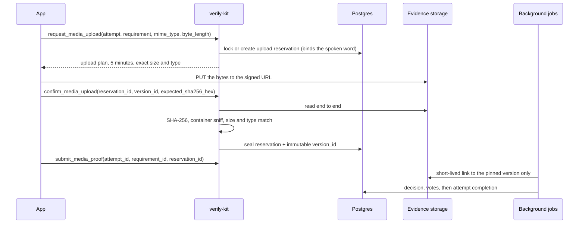

# Evidence storage

Video, photo, and audio proof is stored privately, read once end to end to be
hashed and identified, pinned to an immutable version, and deleted after a
short retention window. Two storage modes share one flow:

| Mode    | Where bytes live                                              | Allowed in                                             |
| ------- | ------------------------------------------------------------- | ------------------------------------------------------ |
| `local` | Local filesystem storage (`LocalEvidenceStorage`)             | `development`, `test` only                             |
| `b2`    | A private, versioned Backblaze B2 bucket (S3v4 API)           | Every run mode; the only one in staging and production |

`VERILY_EVIDENCE_STORAGE_MODE` may be `b2` or `local`. When it is unset,
development and test use B2 if the `VERILY_B2_*` values are present and local
storage otherwise, so a fresh checkout runs end to end with no object storage
and no secret. Staging and production always build B2 and refuse to start
without all five values; a missing secret can never fall back to local disk.

## Flow

- **Paths are server-derived:**
  `action-evidence/<accountId>/<attemptId>/<requirementId>.<ext>`. Clients
  never choose a path, bucket, or storage id.
- **Version pinning.** B2 versions every PUT and does not support
  `If-None-Match`, so confirmation stores the exact `x-amz-version-id` it read
  and every later reader (models, reviewers) requests that version. Local
  storage issues a synthetic `local-sha256-<digest>` version and verifies the
  bytes on read.
- **Integrity seal.** `verily_verification::storage` checks the storage
  response against the reservation and refuses any later path, version,
  checksum, size, or type substitution. The device's binding hash commits to
  the same digest for every media kind.

## Accepted media

The allow-list in `verily_kit/verily_verification/src/storage.rs` is the only
source of truth; a type absent from it can never be reserved, confirmed,
verified, or reviewed.

| Kind  | Content types                                | Largest upload | Duration                  |
| ----- | -------------------------------------------- | -------------- | ------------------------- |
| video | `video/mp4`, `video/quicktime`, `video/webm` | 150 MiB        | Required, within the rule |
| photo | `image/jpeg`, `image/png`, `image/heic`      | 20 MiB         | Never                     |
| audio | `audio/mp4` (m4a), `audio/webm`              | 50 MiB         | Required, within the rule |

Confirmation sniffs the first 4 KiB: JPEG and PNG signatures, the EBML WebM
doctype, and ISO base media `ftyp` brands (HEIF brands, QuickTime `qt`,
audio-only `M4A`/`M4B`/`M4P`, MP4 and 3GP brands). The type the upload was
signed for, the type storage recorded, and the detected container must all
agree, or the object is deleted and the confirmation refused. Sniffing
identifies the container, not the content: the verifier still judges what the
media shows.

## Quotas and leases

| Limit                                   | Value                                 |
| --------------------------------------- | ------------------------------------- |
| Reservations per account per 24 hours   | 12                                    |
| Bytes reserved per account per 24 hours | 500 MiB                               |
| Upload URLs per proof                   | 3                                     |
| Confirmation attempts per proof         | 5                                     |
| Confirmation lease                      | 10 minutes (one inspection at a time) |
| Upload URL lifetime                     | 5 minutes                             |
| Review link lifetime                    | at most 10 minutes (5 by default)     |

One reservation exists per attempt and requirement. A row-locked `reserved` →
`confirming` lease lets only one inspection run at a time; an abandoned lease
recovers after ten minutes.

## Retention

Evidence is kept for 7 days; an open appeal extends it to at most 30 days.
`verily_backend::jobs` sweeps expired reservations and evidence in bounded
batches via `rpc::cron`. Decisions, digests, and audit rows outlive the bytes.

## Backblaze setup (staging and production)

- One private (`allPrivate`) bucket per environment, with versioning on.
- A bucket-scoped application key restricted to the `action-evidence/`
  prefix, with exactly `deleteFiles`, `listBuckets`, `listFiles`,
  `readFiles`, and `writeFiles`. Never reuse an account-wide key.
- Secrets: `VERILY_B2_ENDPOINT`, `VERILY_B2_REGION`, `VERILY_B2_BUCKET`,
  `VERILY_B2_KEY_ID`, `VERILY_B2_APPLICATION_KEY`, resolved through Monosecret
  (optional in development, required in staging and production).
