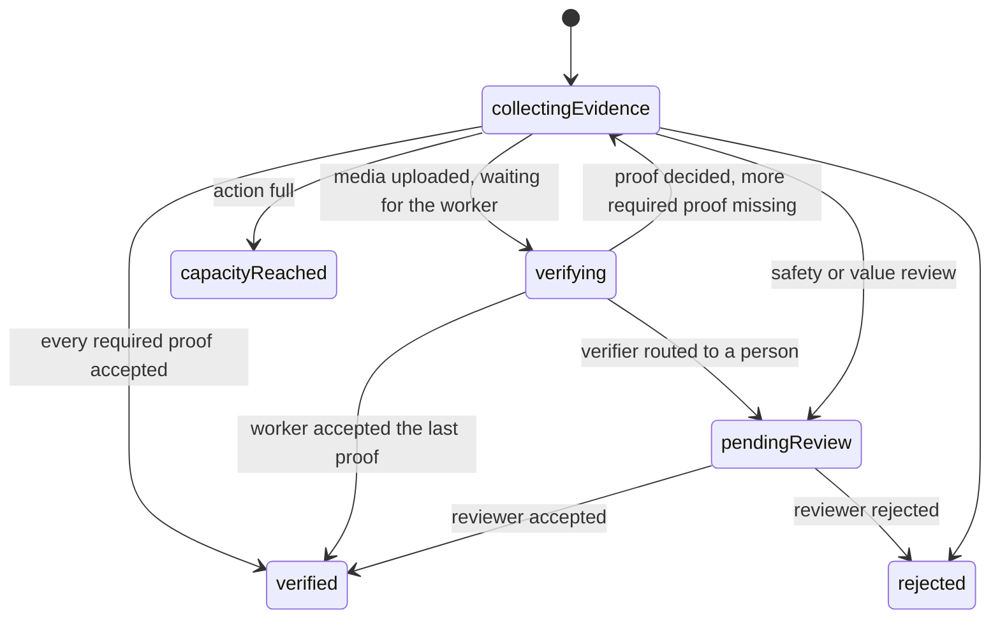

# Action verification

This is how the Verily server turns proof into a verified completion. It covers
actions, requirements, attempts, verifiers, review, and how the pieces lock
together. Evidence bytes are covered in [evidence storage](evidence-storage.md),
model verification in [OpenRouter verification](openrouter-verification.md) and
the [cloud verifier contract](video-verifier-contract.md), escrowed rewards in
[reward escrow](reward-escrow.md), third-party Apps in [platform](platform.md),
and the RPC surface in [Serverpod API](serverpod-api.md).

## Actions are creator-owned

Any signed-in account can create an action. There are no projects: an action
row (`verily_action_definition`) belongs to `creatorAuthUserId` (Restrict on
delete) and is identified by `(creatorAuthUserId, actionKey, revision)`, which
is unique. Two creators can use the same key; one creator cannot reuse theirs.

- **Revisions.** A draft can be edited in place. Editing a published action
  creates the next revision; published revisions never change, and every
  attempt stays tied to the revision whose rules it accepted. Writes carry
  `expectedRevision`, so a stale editor fails instead of overwriting.
- **Status.** `draft` → `active` (published) → `paused` or `completed`.
- **Schedule.** `recurrence` is `once` or `daily`; daily periods are computed in
  the action's IANA `timeZone`. `opensAt`, `closesAt`, and
  `maxVerifiedCompletions` bound when and how often it can be completed.
- **Public creator name.** Participants see `creatorDisplayName`, taken from the
  profile's user name or full name, never an email or account id. Review
  queues, appeals, and moderation cases carry the creator id directly
  (denormalized), so they never join through a project.
- **Templates.** `listTemplates` returns twelve value-free starting points
  (`daily-movement-proof`, `exercise-reps`, `ball-skills`, `place-check-in`,
  `venue-visit`, `event-code`, `gentle-phone-toss`, `yaw-five`, `pitch-three`,
  `roll-three`, `shake-five`, `steady-hand`). They never carry a venue code, an
  App, or a reward.
- **AI drafting.** `draftActionFromPrompt` turns a plain idea into a draft
  proposal through OpenRouter. It is off without `VERILY_OPENROUTER_API_KEY`
  and then throws `ActionDraftingUnavailableException` with friendly copy;
  templates always work. See [OpenRouter verification](openrouter-verification.md).

## Requirements

An action has one to five requirements (`maxActionRequirements`). Each has a
kind and kind-specific rule rows:

| Kind (`ActionRequirementKind`) | Rule table                    | Checked by                                                         |
| ------------------------------ | ----------------------------- | ------------------------------------------------------------------ |
| `video`, `photo`, `audio`      | `verily_action_media_rule`    | Upload pipeline, then a media verifier or a person                 |
| `location`                     | `verily_action_location_rule` | PostGIS radius, accuracy, freshness, travel plausibility           |
| `qrCode`                       | `verily_action_qr_rule`       | Server-issued, single-use, short-lived codes (`verily:v1:` prefix) |
| `motion`                       | `verily_action_motion_rule`   | The phone's sensor trace, recomputed on the server                 |
| `externalApp`                  | `verily_action_external_rule` | A confirmation from the creator's Verily App                       |

`externalApp` is the `external` kind in [platform](platform.md). Serverpod
reserves `external` as an enum value, so the wire name differs; the meaning is
the same.

Media rules are one generalized table for all three media kinds:
verification prompt, duration bounds (none for photos; 3 to 300 seconds for
recordings), minimum confidence, `verificationPolicy` (`singleModel` or
`modelCouncil`), the optional movement or rep target, and
`spokenChallengeRequired`. The upload flow tells the app which content types and
size it accepts (`acceptedContentTypes`, `maxByteLength` on the requirement
view).

Validation happens in `action_requirement_rules.dart` and again in the
database (see [Schema contracts](#schema-contracts)). Creator text that reaches
a model (titles, instructions, verification prompts) passes the central
`ModelInputSecurity` policy at authoring time and again before use.

### No mixing

An action is either third-party or phone-verified, never both. An `externalApp`
requirement must be the only kind on its action, and its App must be one of the
creator's own active Apps. The service enforces this and so do two triggers
(`verily_external_requirement_exclusive_guard`,
`verily_external_rule_creator_guard`).

### Adding a kind or verifier

Kinds and verifiers are deliberately open-ended:

1. Add the enum value to `action_requirement_kind.spy.yaml` and a rule table if
   it needs one. Unknown kinds fall through every exhaustive `switch`, so the
   analyzer lists each place that must decide what the kind means.
2. Decide whether it is media (`mediaKindOf` returns a `MediaEvidenceKind`) or
   deterministic (submitted through `submitEvidence`).
3. Record decisions with a new `verifierType` string. Decisions store the
   verifier type, model name, and model version as bounded text, so a new
   verifier (for example `mp-replay`, below) needs no schema change to be
   audited.

## Attempts

`beginAttempt(actionId, idempotencyKey)` opens one attempt per account and
period (`periodKey` is `once` or the local date for daily actions); repeating
the key returns the same attempt.

- **Deterministic proof** (location, QR, motion) goes through `submitEvidence`
  and is decided in the request.
- **Media proof** goes through `requestMediaUpload` → upload →
  `confirmMediaUpload`. Confirmation queues a durable verification job in the
  same transaction as the evidence and returns `status: null` while the attempt
  is `verifying`.
- **Completion.** `completeAttempt` checks that every required proof has an
  accepted latest decision, ranks the completion, enforces capacity, and
  reserves any payout. For media, the verification worker calls the same
  completion on the participant's behalf right after it commits its decision,
  so a verified recording finishes its attempt without the participant coming
  back. If completion cannot run yet (for example under a safety hold), the
  attempt stays `verifying` and the recovery sweep retries it every five
  minutes. The decision is never lost.

### Capture integrity

`createCaptureChallenge` binds the next proof to a fresh nonce that commits to
the evidence binding hash (`verily-evidence-binding-v1`, from
`packages/verily_evidence`). The binding covers kind, capture time, SHA-256,
byte length, duration (zero for photos), and content type, so a signature or
attestation for one file cannot be reused for another. Device signatures and
Play Integrity are controlled by `VERILY_CAPTURE_SIGNATURE_MODE`
(`optional`/`required`) and `VERILY_DEVICE_INTEGRITY_MODE`
(`disabled`/`required`); production readiness requires both.

### The live spoken challenge

Video and audio proof asks the participant to say a server-chosen word while
recording, so a pre-recorded or generated clip cannot contain it. It is on by
default for video and audio (`spokenChallengeRequired: null` means on), can be
turned off per requirement, and is never allowed on photos.

1. Before recording, the app calls `issueSpokenChallenge(attemptId,
   requirementId)`. The server picks a word from its own list of 200+ short,
   lowercase, unambiguous words (`spoken_challenge_words.dart`), valid for 15
   minutes, at most five issued per proof. Once a word is bound, the call keeps
   returning that word.
2. `requestMediaUpload` refuses to reserve an upload for a requirement that
   needs a word until one is issued, and binds it to the reservation exactly
   once.
3. Confirmation copies the challenge id and word onto the evidence row and
   rejects a capture time earlier than issuance (two minutes of clock
   tolerance).
4. The verifier receives the word as quoted evidence, never as an
   instruction, and reports whether it was heard. Only models that can hear
   the media's audio may vote on the word; image-only models abstain. A single
   model needs to hear it; a council needs two hearing members to agree. A
   council with fewer than two hearing members sends the proof to a person,
   never guesses.

Words expire through a daily cleanup future call.

## Verifiers

Each decision row records `status` (`accepted`, `rejected`, `manualReview`),
`verifierType`, a stable `reasonCode`, short product copy, confidence, and
model provenance. Participants only ever see the product copy.

| `verifierType`                                         | Source                                                   |
| ------------------------------------------------------ | -------------------------------------------------------- |
| `geofence`, `location-risk`                            | Location policy                                          |
| `qr-digest`                                            | Venue codes                                              |
| `device-motion-v1`                                     | Motion trace recomputed on the server                    |
| `media-preflight`, `spoken-challenge`                  | Upload and challenge-word checks before any model runs   |
| `openrouter-single-model`, `openrouter-model-council`  | [OpenRouter verification](openrouter-verification.md)    |
| `cloud-ai-media`                                       | [Cloud verifier contract](video-verifier-contract.md)    |
| `manual-review-fallback`                               | `VERILY_MEDIA_VERIFIER_MODE=manual-review` (the default) |
| `human-review`, `appeal-review`, `payout-value-review` | People with the `evidence.review` scope                  |
| `abuse-risk`                                           | The abuse gate                                           |
| `verily-app`                                           | A Verily App confirmation                                |

`VERILY_MEDIA_VERIFIER_MODE` selects `manual-review` (default, needs no
secret), `openrouter`, or `cloud`. Partial configuration stops startup.

### Not implemented yet: on-device models replayed on the server

[platform](platform.md) describes phone-only kinds (show a gesture, show a
thing, make a sound) checked by MediaPipe models on the phone and replayed on
the server as `verifierType = mp-replay`. They are not in this build: there is
no gesture, object, or sound kind and no server replay. The seam is the
extension path above: a new kind, a rule table with the pinned model URL,
byte length, and SHA-256, and a verifier that runs over the pinned evidence
version and falls back to AI or a person when the runtime is unavailable.

## Review, appeals, and moderation

- **Evidence review** (`evidenceReview`, scope `evidence.review`) lists proofs
  that need a person, with a five-minute private link to the exact pinned
  version, and records `accepted` or `rejected`. Accepting completes the
  attempt; payouts above the review threshold are reserved only after this.
- **Appeals** (`evidenceAppeal`) let a participant contest a rejection;
  the action's creator lists and resolves appeals on their own actions
  (`listOwned`, `resolve`). An open appeal extends evidence retention up to 30 days.
- **Moderation** (`moderation`, `moderationReview` with scope
  `moderation.review`) takes reports on actions, places safety holds, and keeps
  an append-only audit trail (UPDATE and DELETE are rejected by trigger). A
  hold covers every revision of the creator's action key: it blocks new
  attempts and completion and removes the action from discovery lists.
- **Abuse gate** (`VERILY_ABUSE_RUNTIME_MODE`) assesses value-bearing proof
  with rotating HMAC pseudonyms (`verily-abuse-v1`); replays of the same bytes
  across accounts are rejected and flagged completions go to review. Its
  assessments are append-only.

## Nearby discovery

`listNearbyActions(latitude, longitude, radiusKm, limit)` returns live, open
actions with a location requirement within the radius (clamped to 0.1 to 50 km,
limit 1 to 50), nearest first, using PostGIS `ST_DWithin` and `ST_Distance` on
`geography`. Drafts, paused, closed, not-yet-open, and full actions are
excluded, as are actions under a safety hold. The caller's point is coarsened
to about 100 metres, used for the query only, and never stored.

## AI usage without credits

Verily has no credit ledger. Model spend is bounded three ways:

- `InferenceCostPolicy` pins per-model maximum cost, calls per attempt, and
  micros per attempt (`VERILY_AI_*`).
- `InferenceReservationService` reserves cost per attempt under an advisory
  lock before every external model call; a call over budget becomes a failed
  vote, which routes to a person.
- `AiUsageGuard` limits AI drafting per account per UTC day
  (`VERILY_AI_ACTION_DRAFT_DAILY_UNITS`), one active draft at a time; failed
  work still spends its units.

## Locking

Completion and confirmation take locks in one order, which every path follows:

1. the acting account's `AuthUser` row (`AccountAccess.isActive` inside a
   transaction locks it `FOR UPDATE`);
2. the attempt row;
3. the action-key advisory lock `verily:action-key:<creator>:<key>`
   (`ActionKeyLock`), which replaces the old per-project row lock and
   serializes capacity and ranking across revisions;
4. action revision rows;
5. the reward pool row, then payout rows.

App deliveries lock the App row first, then follow the same order. The payout
release job locks only the pool and payout rows and reads accounts without a
lock, so it cannot deadlock with completion.

## Schema contracts

The baseline migration (`verily_server/migrations/20261021141602300-verily-baseline`)
is Serverpod's generated schema plus `tool/schema_contracts.sql`, composed by
`tool/compose_schema_baseline.dart`. The supplement adds only CHECK
constraints, functions, and triggers (no indexes, foreign keys, or columns), so
Serverpod's development-mode schema check still passes. It enforces bounds on
every value-bearing table, append-only receipts and audits, the no-mixing and
creator-binding rules for Apps, frozen reward terms, and payout invariants.
`dart run tool/verify_schema_contracts.dart` checks a live database read-only
(29 constraints, 8 triggers).
