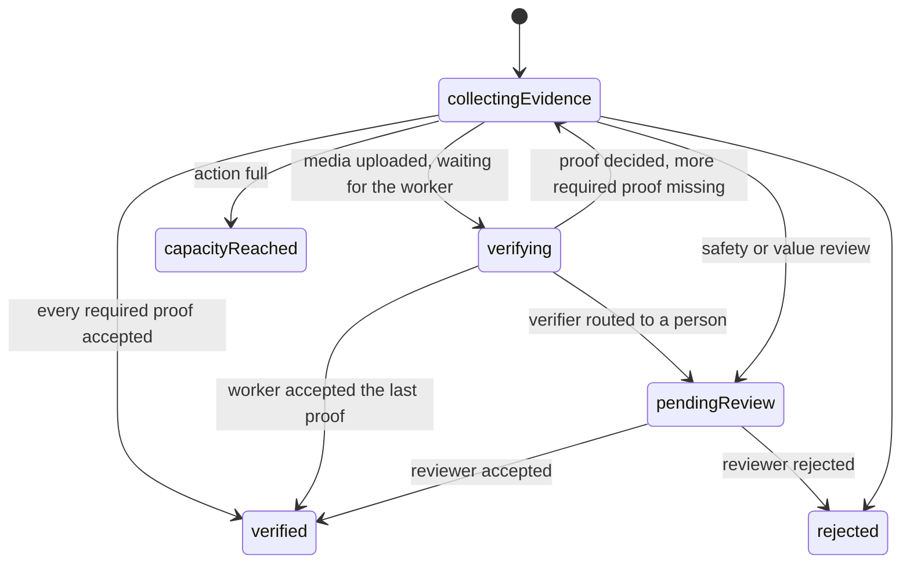
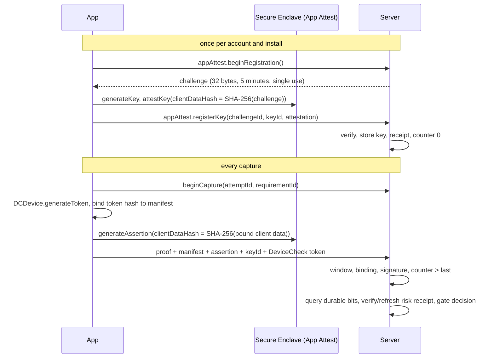

# Action verification

This is how the Verily server turns proof into a verified completion. It covers
actions, requirements, attempts, verifiers, review, and how the pieces lock
together. Evidence bytes are covered in [evidence storage](evidence-storage.md),
model verification in [OpenRouter verification](openrouter-verification.md) and
the [cloud verifier contract](video-verifier-contract.md), escrowed rewards in
[reward escrow](reward-escrow.md), third-party Apps in [platform](platform.md),
and the RPC surface in [Serverpod API](serverpod-api.md).

## Actions are creator-owned

Any signed-in account can create an action. There are no projects: an action
row (`verily_action_definition`) belongs to `creatorAuthUserId` (Restrict on
delete) and is identified by `(creatorAuthUserId, actionKey, revision)`, which
is unique. Two creators can use the same key; one creator cannot reuse theirs.

- **Revisions.** A draft can be edited in place. Editing a published action
  creates the next revision; published revisions never change, and every
  attempt stays tied to the revision whose rules it accepted. Writes carry
  `expectedRevision`, so a stale editor fails instead of overwriting.
- **Status.** `draft` → `active` (published) → `paused` or `completed`.
- **Schedule.** `recurrence` is `once` or `daily`; daily periods are computed in
  the action's IANA `timeZone`. `opensAt`, `closesAt`, and
  `maxVerifiedCompletions` bound when and how often it can be completed.
- **Public creator name.** Participants see `creatorDisplayName`, taken from the
  profile's user name or full name, never an email or account id. Review
  queues, appeals, and moderation cases carry the creator id directly
  (denormalized), so they never join through a project.
- **Templates.** `listTemplates` returns twelve value-free starting points
  (`daily-movement-proof`, `exercise-reps`, `ball-skills`, `place-check-in`,
  `venue-visit`, `event-code`, `gentle-phone-toss`, `yaw-five`, `pitch-three`,
  `roll-three`, `shake-five`, `steady-hand`). They never carry a venue code, an
  App, or a reward.
- **AI drafting.** `draftActionFromPrompt` turns a plain idea into a draft
  proposal through OpenRouter. It is off without `VERILY_OPENROUTER_API_KEY`
  and then throws `ActionDraftingUnavailableException` with friendly copy;
  templates always work. See [OpenRouter verification](openrouter-verification.md).

## Requirements

An action has one to five requirements (`maxActionRequirements`). Each has a
kind and kind-specific rule rows:

| Kind (`ActionRequirementKind`) | Rule table                    | Checked by                                                          |
| ------------------------------ | ----------------------------- | ------------------------------------------------------------------- |
| `video`, `photo`, `audio`      | `verily_action_media_rule`    | Upload pipeline, then a media verifier or a person                  |
| `location`                     | `verily_action_location_rule` | PostGIS radius, accuracy, freshness, travel plausibility            |
| `qrCode`                       | `verily_action_qr_rule`       | Server-issued, single-use, short-lived codes (`verily:v1:` prefix)  |
| `motion`                       | `verily_action_motion_rule`   | The phone's sensor trace, recomputed on the server                  |
| `externalApp`                  | `verily_action_external_rule` | The creator's Verily App: it pushes a confirmation, or Verily pulls |

`externalApp` is the `external` kind in [platform](platform.md). Serverpod
reserves `external` as an enum value, so the wire name differs; the meaning is
the same. Its rule records `verificationMode`: `push` (the App calls
`POST /api/v1/confirmations`) or `pull` (the participant taps "I did it" with
`requestAppVerification` and Verily calls the App's webhook; see
[platform](platform.md#verification-push-or-pull)).

A media requirement may also carry a `localCheck` (gesture, object, or sound),
replayed on the server; see [below](#on-device-checks-replayed-on-the-server-mp-replay).

Media rules are one generalized table for all three media kinds:
verification prompt, duration bounds (none for photos; 3 to 300 seconds for
recordings), minimum confidence, `verificationPolicy` (`singleModel` or
`modelCouncil`), the optional movement or rep target, and
`spokenChallengeRequired`. The upload flow tells the app which content types and
size it accepts (`acceptedContentTypes`, `maxByteLength` on the requirement
view).

Validation happens in `action_requirement_rules.dart` and again in the
database (see [Schema contracts](#schema-contracts)). Creator text that reaches
a model (titles, instructions, verification prompts) passes the central
`ModelInputSecurity` policy at authoring time and again before use.

### No mixing

An action is either third-party or phone-verified, never both. An `externalApp`
requirement must be the only kind on its action, and its App must be one of the
creator's own active Apps. The service enforces this and so do two triggers
(`verily_external_requirement_exclusive_guard`,
`verily_external_rule_creator_guard`).

### Adding a kind or verifier

Kinds and verifiers are deliberately open-ended:

1. Add the enum value to `action_requirement_kind.spy.yaml` and a rule table if
   it needs one. Unknown kinds fall through every exhaustive `switch`, so the
   analyzer lists each place that must decide what the kind means.
2. Decide whether it is media (`mediaKindOf` returns a `MediaEvidenceKind`) or
   deterministic (submitted through `submitEvidence`).
3. Record decisions with a new `verifierType` string. Decisions store the
   verifier type, model name, and model version as bounded text, so a new
   verifier (for example `mp-replay`, below) needs no schema change to be
   audited.

## Attempts

`beginAttempt(actionId, idempotencyKey)` opens one attempt per account and
period (`periodKey` is `once` or the local date for daily actions); repeating
the key returns the same attempt.



- **Deterministic proof** (location, QR, motion) goes through `submitEvidence`
  and is decided in the request.
- **Media proof** goes through `requestMediaUpload` → upload →
  `confirmMediaUpload`. Confirmation queues a durable verification job in the
  same transaction as the evidence and returns `status: null` while the attempt
  is `verifying`.
- **Completion.** `completeAttempt` checks that every required proof has an
  accepted latest decision, ranks the completion, enforces capacity, and
  reserves any payout. For media, the verification worker calls the same
  completion on the participant's behalf right after it commits its decision,
  so a verified recording finishes its attempt without the participant coming
  back. If completion cannot run yet (for example under a safety hold), the
  attempt stays `verifying` and the recovery sweep retries it every five
  minutes. The decision is never lost.

### Capture integrity

Proof the phone vouches for is captured inside a **capture window** the server
opens before the camera, microphone, sensors, or scanner start. This is Phase 1
of [provenance and watermarking](provenance-and-watermarking.md#7-phased-plan)
on Android; iPhones sign with App Attest from Phase 2 (see
[Apple App Attest](#apple-app-attest)).

```mermaid
sequenceDiagram
  participant App
  participant Keystore as Android Keystore
  participant Server
  App->>Server: beginCapture(attemptId, requirementId)
  Server-->>App: captureChallenge (32 bytes), expiresAt; records T0
  App->>Keystore: fresh P-256 key, attestation challenge SHA-256(captureChallenge ‖ attemptId)
  Note over App: capture (camera warms up while the key is made)
  App->>App: binding hash, request hash, manifest
  App->>Server: proof + Play Integrity token + signature + certificate chain
  Server->>Server: window, T0, binding, Play Integrity, chain, signature
```

1. **Open.** `beginCapture(attemptId, requirementId)` records the window's
   start (`T0`) and returns `captureChallenge`: 32 random bytes, unpadded
   base64url. A window stays open for 30 minutes (time on the capture screen,
   the longest recording, and its upload); an attempt may open ten an hour.
2. **Key.** The app generates a fresh P-256 signing key for this window in
   the Android Keystore, in StrongBox when the device has it and the Trusted
   Execution Environment otherwise, with
   `setAttestationChallenge(SHA-256(captureChallenge ‖ attemptId))` (the
   challenge's raw bytes, then the attempt id as UTF-8). Generation runs while
   the camera warms up. Keys from closed windows, and the single long-lived
   key earlier builds used, are deleted.
3. **Bind.** After capture the app computes the evidence binding hash
   (`verily-evidence-binding-v1`, from `packages/verily_evidence`), which
   covers kind, capture time, SHA-256, byte length, duration (zero for
   photos), and content type, so nothing vouching for one file can vouch for
   another. The Play Integrity request hash (`verily-capture-request-v2`)
   commits to the attempt, requirement, binding, and `captureChallenge`. The
   app asks Play for a token over that hash and signs the manifest
   (`verily-capture-manifest-v1`: attempt, requirement, request hash, binding)
   with the window's key, then sends the token, the manifest, the IEEE P1363
   signature, and the key's certificate chain (`captureCertificateChain`, DER,
   leaf first).
4. **Verify.** The server loads the unused window, refuses proof captured
   before `T0` (two minutes of clock tolerance; `capture_predates_challenge`),
   and recomputes the binding and request hash from the evidence it accepted.
   It then checks Play Integrity, the manifest, the attestation chain, and the
   signature with the attested key. The window is consumed once and records
   the request hash, binding, provider, and verdict.

The phone never says where its key lives: the key, its id, and its storage
level come only from the attestation chain, or on an iPhone from the App
Attest key the account registered.

#### Android Key Attestation

`key_attestation/` ports the checks in Google's
[`android/keyattestation`](https://github.com/android/keyattestation) verifier
and adds Verily's policy. Its unit tests run that project's recorded device
chains (`test/unit/action_verification/key_attestation/vectors`) and a
synthetic test authority for every refusal.

- **Chain.** Certificates chain by name and signature to a root pinned in
  `google_attestation_roots.dart`: the legacy RSA-4096 root and the ECDSA
  P-384 "Key Attestation CA1" root (signing since 1 February 2026, exclusive
  for remotely provisioned devices from 10 April 2026). A root is matched by
  name and key, never by validity, so re-issued and expired versions of the
  RSA root keep working. Every certificate but the leaf (whose dates the
  device writes) must be within its validity, except that expiry is ignored on
  factory-provisioned chains, whose keys cannot rotate.
- **Revocation.** No serial in the chain may be on Google's status list
  (`https://android.googleapis.com/attestation/status`), revoked or
  suspended. The list is cached for its `Cache-Control: max-age` less `Age`
  (at most a day). A failed refresh keeps the last list for 24 hours; with no
  usable list, attestation fails closed.
- **Extension.** Only the leaf may carry the `KeyDescription` extension, the
  strict form of "parse it from the certificate closest to the root": an
  attested key cannot extend the chain with a certificate of its own.
- **Policy.** The attestation challenge is the window's; attestation and
  KeyMint security levels agree and are TEE or StrongBox, and StrongBox only
  when the chain itself says StrongBox; verified boot is `Verified` and the
  bootloader locked; the key was generated on the device, is EC P-256, and can
  sign; the app is `fun.verily.app` signed with a certificate in
  `VERILY_ANDROID_SIGNING_CERT_SHA256`; the OS security patch is at most 12
  months old.

Refusals carry `capture_attestation_*` reason codes, which participants see
as `capture_not_verified`.

#### Apple App Attest

An iPhone cannot attest a fresh key per window the way Android can: App
Attest keys are made once per install and attested by Apple's servers, which
Apple asks apps to call rarely. So an iPhone registers one key per account and
install, then signs each window's manifest with an **assertion** by that key.



- **Registration** (`appAttest.beginRegistration`, then
  `appAttest.registerKey`). The challenge is 32 random bytes for the caller
  only, valid for five minutes, used once whatever the outcome, and limited
  to ten an hour. `app_attest/app_attest_verifier.dart` follows Apple's
  [validation steps](https://developer.apple.com/documentation/devicecheck/validating-apps-that-connect-to-your-server):
  the attestation is strict CBOR (`app_attest/cbor.dart` refuses indefinite
  lengths, tags, floats, and repeated keys); the credential certificate
  chains by name and signature to the pinned Apple App Attestation Root CA
  (`apple_app_attestation_root.dart`), every certificate within its validity
  (Apple writes three-day credential certificates); only the credential
  certificate may carry the nonce extension (OID `1.2.840.113635.100.8.2`),
  and it must equal `SHA-256(authData ‖ SHA-256(challenge))`; the
  certificate's key hashes to the key id the app named, which is also the
  authenticator data's credential id and its COSE key; `rpIdHash` is
  `SHA-256(TeamID.BundleID)`; the counter is zero; `aaguid` is `appattest`
  and seven zero bytes in production or `appattestdevelop` in Apple's
  sandbox, whichever the server is configured for. When the authenticator
  data reports Apple's validation category, production accepts only
  TestFlight and App Store builds, and the sandbox only development-signed
  and ad hoc builds; iOS versions that report none (iOS 18 and earlier) are
  judged on the rest.
- **Storage.** The `verily_app_attest_key` row keeps the public key, its id
  (SHA-256 of the key, hex, the same `captureKeyId` evidence rows carry),
  the environment, the certificate chain, Apple's receipt, the validation
  category and bundle version, and the last counter. A key belongs to one
  account: registering a key another account holds is refused, as Apple
  advises. Receipt creation, refresh and expiration times and the verified
  risk metric are stored with the latest verified receipt.
- **Assertion.** The proof carries the manifest, the assertion as
  `captureSignature`, and the key id as `captureAppAttestKeyId` (never with a
  certificate chain), plus the ephemeral `captureDeviceCheckToken`. The
  assertion signs `appAttestDeviceClientData(manifest, token)`: domain
  `verily-apple-device-v1`, the manifest length and bytes, and SHA-256 of the
  token. The server finds the caller's own key, checks the
  ECDSA P-256 signature over
  `SHA-256(authenticatorData ‖ SHA-256(clientData))`, the `rpIdHash`, and the
  validation category, and then, under a row lock, that the counter is larger
  than the last accepted one, which it stores. A replayed or reordered
  assertion is refused with `capture_app_attest_replayed`.
- **Fraud receipt.** Both the initial `ATTEST` and refreshed `RECEIPT` pass
  PKCS#7 signature verification and a certificate path to the pinned Apple
  Root CA - G3 (separate from the credential root). Bounded BER envelope
  decoding handles Apple's fragmented payload without rewriting signed
  payload bytes. Field 2 must equal `TeamID.BundleID`, field 12 must be at
  most five minutes old and not in the future, and field 3's credential
  certificate must contain the attested P-256 key. Only a verified `RECEIPT`
  supplies field 17, the approximate number of attested keys on this device
  in 30 days. A metric **at least 10** forces `device_activity_risk` manual
  review; it never automatically bans a device. This starting threshold
  needs tuning against legitimate reinstall and account use.
- **Refresh.** Server-to-server requests use ES256 DeviceCheck JWTs and the
  latest verified receipt at `data.appattest.apple.com`, or
  `data-development.appattest.apple.com` for sandbox keys. A ten-minute
  recurring task refreshes due rows in bounded batches; capture verification
  can refresh too. The key row lock serializes both. Neither path refreshes
  before field 19 or after field 21. Failed calls preserve the prior receipt
  and back off for one hour. Missing, expired, invalid or due-but-unrefreshed
  metrics hold automatic acceptance (`apple_device_risk_unavailable`), even
  when a previous metric was low. If prolonged downtime lets a receipt
  expire, the install needs a newly attested key; expired receipts cannot
  restore automatic verification.
- **Durable device restrictions.** `DCDevice.generateToken` supplies a fresh
  token for each assertion. Apple stores bit 0 as an **active abuse ban**
  (capture refused) and bit 1 as **review required** (manual review after
  suspected abuse). Both flags survive app reinstalls; neither is an
  identity or proof of unique personhood. Only `device-check.manage`
  operators may query/update them through `deviceCheck`, using a fresh token
  from the affected phone. Both bits are explicit on update; clearing a ban
  does not implicitly clear the review flag. Update intent and completion
  are audited, including operator, note and ephemeral token hash. An
  interrupted update must be queried before deciding its outcome.
  Participant APIs cannot choose or clear bit values. Raw tokens are never
  logged or persisted. A missing token or failed Apple query holds proof for
  review; an unsigned capture remains subject to capture-signature policy.
  DeviceCheck provides no cryptographic way to prove its token and an App
  Attest key came from the same phone: assertion binding prevents substitution
  in transit, but a compromised device can still relay a clean phone's token.
- **Credentials.** Provision a DeviceCheck-enabled Apple P-256 `.p8` key
  through Monosecret as `VERILY_DEVICE_CHECK_PRIVATE_KEY`, with its
  `VERILY_DEVICE_CHECK_KEY_ID` and `VERILY_APPLE_TEAM_ID`. Local private keys
  belong in the ignored mode-0600 `.env` via the dotenv provider; deployment
  receives environment values through Monosecret bootstrap. Never commit a
  key or resolve it per request. No credential is configured by this change;
  absent configuration holds verification honestly. HTTP clients and test
  receipt authorities are injectable. Destinations are fixed, redirects are
  disabled, responses and timeouts are bounded, and requests are not retried.
- **What it proves.** Apple vouches that a genuine Apple device running
  Verily's app holds the key in its Secure Enclave, and the assertion binds
  this window's manifest. App Attest has **no verified-boot or jailbreak
  signal**, and its key is per install rather than per window, so a valid
  assertion records `secureEnclaveAttested`, never `hardwareAttested`. A
  jailbroken device can still serve assertions; reward sizing and review
  stay the backstop.
- **On the phone.** `AppAttestCaptureKeyStore` registers lazily when the first
  window opens, keeping each account's key id in the Keychain (this device
  only; App Attest keys do not survive a restore). A phone without App Attest
  (`isSupported` false, such as the simulator) signs nothing, and the server
  applies `VERILY_CAPTURE_SIGNATURE_MODE`. Apple's `serverUnavailable` keeps
  the key for a retry; any other failure, or a key the server rejects,
  discards it so the next window starts again.

Refusals carry `capture_app_attest_*` reason codes (and
`capture_signature_invalid`), which participants see as
`capture_not_verified`. Physical-iPhone and live Apple API acceptance testing
remain outstanding; no physical iPhone was used for this implementation.
Use the [physical iPhone acceptance checklist](iphone-acceptance.md) to record
Monosecret provisioning, live receipt refresh and restrictions across reinstalls.

#### Play Integrity

`device_integrity_verifier.dart` requires a verdict for this exact request,
package, and recognised build from the last two minutes, and
`MEETS_DEVICE_INTEGRITY`. On top:

- **Strong integrity for large rewards.** Proof toward an action whose funded
  reward pays above the review threshold
  (`VERILY_REWARD_REVIEW_THRESHOLD_ATOMS`) needs `MEETS_STRONG_INTEGRITY` (a
  security patch from the last year on Android 13+), or it is refused with
  `device_integrity_not_strong`.
- **Capture risks go to a person.** An unknown app capturing the screen,
  controlling the device, or drawing overlays (`appAccessRiskVerdict`:
  `UNKNOWN_CAPTURING`, `UNKNOWN_CONTROLLING`, `UNKNOWN_OVERLAYS`) routes the
  proof to review as `device_capture_risk`; recent device activity at
  `LEVEL_3` or `LEVEL_4` routes it as `device_activity_risk`. Reviewers see
  both as `security_review`. Play-installed apps with those abilities are not
  flagged. Both signals must be enabled in the Play Console; when absent they
  flag nothing.
- **Signing certificate.** With `VERILY_ANDROID_SIGNING_CERT_SHA256` set,
  `appIntegrity.certificateSha256Digest` must include one of its digests.

#### Provenance levels

Each proof records the strongest level the server verified:

| `EvidenceProvenanceLevel` | Means                                                                                                                       |
| ------------------------- | --------------------------------------------------------------------------------------------------------------------------- |
| `basic`                   | Bound to a capture window only                                                                                              |
| `appAttested`             | Play Integrity vouched for the app and device                                                                               |
| `deviceSigned`            | A key signed the capture but its attestation was not trusted (optional mode)                                                |
| `secureEnclaveAttested`   | The account's App Attest key, in the Secure Enclave of a genuine Apple device running our app, asserted it (no boot signal) |
| `hardwareAttested`        | A fresh key in the TEE or StrongBox of a locked, verified device running our signed app, created for this window, signed it |

The evidence row keeps the manifest, signature, the attested public key and
its id, `captureKeyStorage` (`strongBox` or `trustedEnvironment` from a
trusted Android attestation, `secureEnclave` from a registered App Attest
key), the Android certificate chain (so later revocations can be checked
against past proof; an App Attest key keeps its chain on its own row), and
`captureDeviceKeyId`: the SHA-256 of the remotely provisioned attestation key
that certified the capture key. That key is hardware-bound and rotates every
few weeks, so it is the abuse gate's device pseudonym; factory-provisioned
keys are shared by a batch of devices and give none, and neither does App
Attest, whose keys are per account.

#### Configuration

- `VERILY_CAPTURE_SIGNATURE_MODE`: `optional` (default) or `required`.
  `required` means every proof carries a manifest signed by a key whose
  attestation verifies: an attested Android key or a registered App Attest
  key. `optional` records an untrusted Android attestation (an emulator, a
  debug build signed with another certificate) as `deviceSigned`; a manifest
  or signature that does not verify is refused in both modes. There is no
  untrusted App Attest signature: an assertion verifies against a registered
  key or is refused.
- `VERILY_DEVICE_INTEGRITY_MODE`: `disabled` (default) or `required`.
- `VERILY_ANDROID_SIGNING_CERT_SHA256`: hex SHA-256 of the release signing
  certificate (the Play app-signing certificate for Play builds),
  comma-separated during a rotation. Without it no attestation is trusted.
- `VERILY_APPLE_TEAM_ID`: the ten-character Apple team id (App ID prefix).
  Unset turns App Attest off: registration answers
  `AppAttestException(unavailable)` and assertions are refused.
- `VERILY_IOS_BUNDLE_ID`: the iOS bundle id (default `fun.verily.app`).
- `VERILY_APP_ATTEST_ENVIRONMENT`: `production` (default) or `development`.
  Builds from the App Store, TestFlight, or the enterprise program always use
  production; Xcode builds without the App Attest entitlement (the app sets
  none) use Apple's sandbox, which only a server running in development or
  test may accept.

A malformed value, `required` signatures without a signing certificate, or
the sandbox outside development stops startup. Production readiness (the
abuse-resistance gate) requires the first three. With signatures required,
iPhones also need `VERILY_APPLE_TEAM_ID`, or their proof is refused.

### The live spoken challenge

Video and audio proof asks the participant to say a server-chosen word while
recording, so a pre-recorded or generated clip cannot contain it. It is on by
default for video and audio (`spokenChallengeRequired: null` means on), can be
turned off per requirement, and is never allowed on photos.

1. Before recording, the app calls `issueSpokenChallenge(attemptId,
   requirementId)`. The server picks a word from its own list of 200+ short,
   lowercase, unambiguous words (`spoken_challenge_words.dart`), valid for 15
   minutes, at most five issued per proof. Once a word is bound, the call keeps
   returning that word.
2. `requestMediaUpload` refuses to reserve an upload for a requirement that
   needs a word until one is issued, and binds it to the reservation exactly
   once.
3. Confirmation copies the challenge id and word onto the evidence row and
   rejects a capture time earlier than issuance (two minutes of clock
   tolerance).
4. The verifier receives the word as quoted evidence, never as an
   instruction, and reports whether it was heard. Only models that can hear
   the media's audio may vote on the word; image-only models abstain. A single
   model needs to hear it; a council needs two hearing members to agree. A
   council with fewer than two hearing members sends the proof to a person,
   never guesses.

Words expire through a daily cleanup future call.

## Verifiers

Each decision row records `status` (`accepted`, `rejected`, `manualReview`),
`verifierType`, a stable `reasonCode`, short product copy, confidence, and
model provenance. Participants only ever see the product copy.

| `verifierType`                                         | Source                                                       |
| ------------------------------------------------------ | ------------------------------------------------------------ |
| `geofence`, `location-risk`                            | Location policy                                              |
| `qr-digest`                                            | Venue codes                                                  |
| `device-motion-v1`                                     | Motion trace recomputed on the server                        |
| `media-preflight`, `spoken-challenge`                  | Upload and challenge-word checks before any model runs       |
| `google-play-integrity`, `android-key-attestation`     | [Capture integrity](#capture-integrity) refusals and reviews |
| `openrouter-single-model`, `openrouter-model-council`  | [OpenRouter verification](openrouter-verification.md)        |
| `cloud-ai-media`                                       | [Cloud verifier contract](video-verifier-contract.md)        |
| `manual-review-fallback`                               | `VERILY_MEDIA_VERIFIER_MODE=manual-review` (the default)     |
| `human-review`, `appeal-review`, `payout-value-review` | People with the `evidence.review` scope                      |
| `abuse-risk`                                           | The abuse gate                                               |
| `verily-app`, `verily-app-pull`                        | A Verily App's push confirmation or pull verdict             |
| `mp-replay`                                            | A local check replayed on the server with the pinned model   |

`VERILY_MEDIA_VERIFIER_MODE` selects `manual-review` (default, needs no
secret), `openrouter`, or `cloud`. Partial configuration stops startup.

These internal codes are for audit and review. The app only ever sees the
public codes in [Serverpod API](serverpod-api.md#reason-codes-the-app-sees):
views map every internal code, including any reason an App sent, onto that
set.

### On-device checks replayed on the server (mp-replay)

A video, photo, or audio requirement can carry a **local check**: something a
MediaPipe model recognizes, checked live on the phone and then replayed on the
server with exactly the same model.

| Task      | Media          | Model (pinned)                          | Labels                                  |
| --------- | -------------- | --------------------------------------- | --------------------------------------- |
| `gesture` | photo or video | Gesture recognizer, float16 v1 (8.4 MB) | The seven canned gestures (`Thumb_Up`…) |
| `object`  | photo or video | EfficientDet-Lite0, int8 v1 (4.6 MB)    | The 80 COCO classes                     |
| `sound`   | audio          | YAMNet, float32 v1 (4.1 MB)             | A reviewed subset of AudioSet sounds    |

- **Rule.** `localCheck: {task, label, minScore, minFrames}` on the media rule:
  a label from the allow-list (`LocalCheckModel` in `packages/verily_evidence`,
  shared by the server's validation and the app's editor), a minimum
  score of 0.3 to 0.99, and 1 to 30 matching frames or audio windows (one for a
  photo). Without a creator prompt the server writes the verification text
  from the label, so no creator text reaches a model.
- **Pinning.** Models are pinned by Google's versioned `mediapipe-models` URL,
  byte length, and SHA-256. The phone receives them in `localCheckModel`; the
  server downloads each once into its cache
  (`VERILY_LOCAL_CHECK_MODEL_CACHE`, baked into the image) and re-checks length
  and digest on every load, discarding anything that does not match.
- **Replay.** The worker reads the sealed evidence bytes (digest and length
  re-checked) and decodes them with ffmpeg: a photo is one frame, a video 30
  evenly spaced frames scaled to at most 640 px, audio 16 kHz mono PCM capped
  at 300 s. ffmpeg runs with argument lists, a 20-second timeout, bounded
  output, and a private temp directory that is always deleted. The decision is
  `verifierType = mp-replay`, with the model id as model name and its SHA-256
  as model version; it is accepted (`local_check_matched`) when at least
  `minFrames` frames score at least `minScore` for the label, otherwise
  rejected (`local_check_not_matched`). Confidence is the best score.
- **The phone's result is advisory.** `MediaUploadConfirmation.deviceLocalCheck`
  (model id, SHA-256, label, score, matched frames) is stored on the evidence
  row for calibration, only when the rule has a local check, and never feeds a
  decision.
- **Spoken word.** A model cannot hear words, so the spoken challenge is off by
  default for a local check. When a creator turns it on, the replay is recorded
  as a vote and the AI policy or a person decides.
- **No runtime, no shortcut.** When the replay cannot run (runtime missing,
  model download or digest failure, unreadable evidence, decode failure) the
  rule's AI policy decides; under manual review the reason is
  `mp_replay_unavailable`. The failed replay is kept as a vote with its code
  (`mp_runtime_unavailable`, `mp_model_download_failed`,
  `mp_model_digest_mismatch`, `mp_evidence_unreadable`,
  `mp_evidence_digest_mismatch`, `mp_decoder_unavailable`,
  `mp_media_decode_failed`, or `mp_replay_failed`).
- **Runtime.** The server uses the published `mp_core`, `mp_vision`, and
  `mp_audio` 0.1.3 packages, whose build hook downloads the pinned native
  MediaPipe runtime. It is published for macOS arm64 and Linux x64 only. The
  image installs `ffmpeg` and `libstdc++6`; its bundled Linux libraries need
  glibc 2.39 and the libstdc++ of GCC 13 or newer, which Debian trixie
  provides.

#### Replay scores by host

The same pinned public fixtures, replayed with the pinned models. Linux x64 is
the production image (`linux/amd64`, Debian trixie, ffmpeg 7.1.5), run by
`devenv shell test:server-image` ([local CI](local-ci.md)) on 2026-10-22.

| Fixture                   | Check      | macOS arm64        | Linux x64 (image)  |
| ------------------------- | ---------- | ------------------ | ------------------ |
| Thumbs-up photo           | `Thumb_Up` | 0.73               | 0.73               |
| Thumbs-up photo           | `Victory`  | 0.00               | 0.00               |
| Thumbs-up video, 2 s      | `Thumb_Up` | 0.73, 29/29 frames | 0.73, 29/29 frames |
| Cat-and-dog photo         | `dog`      | 0.89               | 0.89               |
| Cat-and-dog photo         | `cat`      | 0.82               | 0.80               |
| Cat-and-dog photo         | `bicycle`  | 0.01               | 0.01               |
| Speech clip (16 kHz mono) | `Speech`   | 1.00, 4/5 windows  | 1.00, 4/5 windows  |
| Speech clip (16 kHz mono) | `Clapping` | 0.01               | 0.01               |

Every verdict agrees; scores differ by at most 0.02 (the object detector on
`cat`), well inside the 0.3 to 0.99 range creators may set. A video samples 29
frames, not 30, because the last seek lands past the final decodable frame.

The Linux run was emulated: Podman's Apple Silicon VM runs `linux/amd64` under
QEMU user emulation (it disables Rosetta on kernel 6.13 and newer), so its
timings say nothing about production. The replay suite took about 2 min 20 s
there against 9 s natively on macOS, and a cold image build took 22 to 45
minutes. Emulation changes speed, not scores, because QEMU runs the image's
own x86 instructions; the `cat` difference is between the x86 and arm64
builds of the runtime.

## Review, appeals, and moderation

- **Evidence review** (`evidenceReview`, scope `evidence.review`) lists proofs
  that need a person, with a five-minute private link to the exact pinned
  version, and records `accepted` or `rejected`. Accepting completes the
  attempt; payouts above the review threshold are reserved only after this.
- **Appeals** (`evidenceAppeal`) let a participant contest a rejection;
  the action's creator lists and resolves appeals on their own actions
  (`listOwned`, `resolve`). An open appeal extends evidence retention up to 30 days.
- **Moderation** (`moderation`, `moderationReview` with scope
  `moderation.review`) takes reports on actions, places safety holds, and keeps
  an append-only audit trail (UPDATE and DELETE are rejected by trigger). A
  hold covers every revision of the creator's action key: it blocks new
  attempts and completion and removes the action from discovery lists.
- **Abuse gate** (`VERILY_ABUSE_RUNTIME_MODE`) assesses value-bearing proof
  with rotating HMAC pseudonyms (`verily-abuse-v1`); replays of the same bytes
  across accounts are rejected and flagged completions go to review. Its
  device pseudonym is the attested `captureDeviceKeyId`, never a key the
  phone chose. Its assessments are append-only.

## Nearby discovery

`listNearbyActions(latitude, longitude, radiusKm, limit)` returns live, open
actions with a location requirement within the radius (clamped to 0.1 to 50 km,
limit 1 to 50), nearest first, using PostGIS `ST_DWithin` and `ST_Distance` on
`geography`. Drafts, paused, closed, not-yet-open, and full actions are
excluded, as are actions under a safety hold. The caller's point is coarsened
to about 100 metres, used for the query only, and never stored.

## AI usage without credits

Verily has no credit ledger. Model spend is bounded three ways:

- `InferenceCostPolicy` pins per-model maximum cost, calls per attempt, and
  micros per attempt (`VERILY_AI_*`).
- `InferenceReservationService` reserves cost per attempt under an advisory
  lock before every external model call; a call over budget becomes a failed
  vote, which routes to a person.
- `AiUsageGuard` limits AI drafting per account per UTC day
  (`VERILY_AI_ACTION_DRAFT_DAILY_UNITS`), one active draft at a time; failed
  work still spends its units.

## Locking

Completion and confirmation take locks in one order, which every path follows:

1. the acting account's `AuthUser` row (`AccountAccess.isActive` inside a
   transaction locks it `FOR UPDATE`);
2. the attempt row;
3. the action-key advisory lock `verily:action-key:<creator>:<key>`
   (`ActionKeyLock`), which replaces the old per-project row lock and
   serializes capacity and ranking across revisions;
4. action revision rows;
5. the reward pool row, then payout rows.

Every App request (confirmations, API actions, link exchanges, verification
requests) locks the App row first, then follows the same order; a
verification request row is locked after the account and before completion
reaches it. The payout release job locks only the pool and payout rows and
reads accounts without a lock, so it cannot deadlock with completion.
Outbound webhook calls (event deliveries and pull checks) run outside every
transaction: a short lease is claimed, the call is made, and the result is
recorded in a second transaction.

When an attempt settles, `AttemptSettlementHooks` runs inside the completing
transaction: it queues `attempt.verified` or `attempt.rejected` for the App
behind the action and settles a verification request whose private action it
is. Payout releases queue `payout.released` the same way. Events are delivered
after commit, or by the one-minute recovery sweep.

## Schema contracts

The baseline migration (`verily_server/migrations/20261021215105708-verily-baseline`)
is Serverpod's generated schema plus `tool/schema_contracts.sql`, composed by
`tool/compose_schema_baseline.dart`. The supplement adds only CHECK
constraints, functions, and triggers (no indexes, foreign keys, or columns), so
Serverpod's development-mode schema check still passes. It enforces bounds on
every value-bearing table, append-only receipts and audits, the no-mixing and
creator-binding rules for Apps, frozen reward terms, and payout invariants.
`dart run tool/verify_schema_contracts.dart` checks a live database read-only
(42 constraints, 9 triggers).
