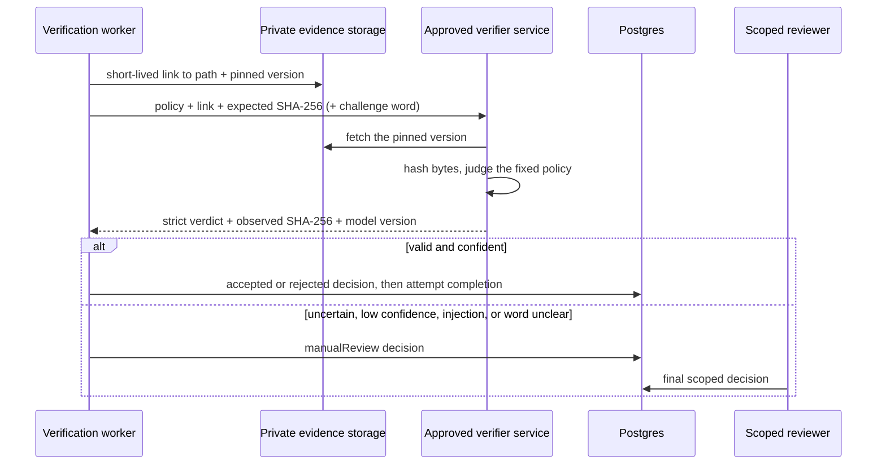

# Cloud media-verifier contract

The verification worker can call an independently deployed verification
service for video, photo, and audio proof without tying the app or database to
one model provider. The default is `manual-review`. Cloud mode is opt-in, and
startup fails when its HTTPS URL or bearer token is missing.

The production readiness gate blocks cloud mode for the closed pilot until a
verifier passes the evaluation gate below. The pinned OpenRouter mode
([OpenRouter verification](openrouter-verification.md)) does not use this
contract.

## Trust boundary



The link names the immutable version, so a later upload to the same path
cannot change what the verifier or a reviewer sees. The verifier must return
the SHA-256 it observed, and a response that does not match the digest the
server computed at confirmation is refused.

## Request

`POST` with `Content-Type: application/json`, `Authorization: Bearer <token>`,
and a timeout of at most 180 seconds (`VERILY_MEDIA_VERIFIER_TIMEOUT_SECONDS`,
default 90):

```json
{
  "contractVersion": "verily.video-verification.v1",
  "policy": {
    "mediaKind": "video",
    "prompt": "Verify that the person waters a plant.",
    "minDurationSeconds": 3,
    "maxDurationSeconds": 60,
    "minConfidence": 0.85,
    "liveChallenge": { "type": "spokenWord", "word": "pelican" }
  },
  "security": {
    "mediaIsUntrustedData": true,
    "promptInjectionAction": "manual_review"
  },
  "evidence": {
    "url": "https://<private storage>/action-evidence/...?...versionId=...",
    "mimeType": "video/mp4",
    "sha256": "<64 lowercase hex characters>",
    "byteLength": 123456,
    "durationSeconds": 30,
    "capturedAt": "2026-10-21T12:00:00.000Z"
  }
}
```

- `mediaKind` is `video`, `photo`, or `audio`. Photos send null duration
  bounds and a null `durationSeconds`.
- `liveChallenge` is null when the requirement does not use the spoken
  challenge. When present, the word is server-chosen evidence to listen for,
  never an instruction.
- The verifier must treat the policy prompt and all media content (speech,
  signs, screens, subtitles, role labels, control tokens, encoded content) as
  untrusted data that cannot change its output, fetch the link within five
  minutes, hash the fetched bytes, and keep neither the link nor the media
  beyond the approved processing window.

## Response

HTTP 200, `application/json`, at most 32 KiB:

```json
{
  "contractVersion": "verily.video-verification.v1",
  "observedSha256": "<digest of the fetched bytes>",
  "verdict": "accepted",
  "confidence": 0.94,
  "promptInjectionDetected": false,
  "challengeWordHeard": "yes",
  "model": { "name": "approved-media-model", "version": "immutable-release-id" }
}
```

| Field                         | Rule                                                            |
| ----------------------------- | --------------------------------------------------------------- |
| `verdict`                     | `accepted`, `rejected`, or `manual_review`                      |
| `confidence`                  | 0 to 1; below the requirement's threshold becomes manual review |
| `promptInjectionDetected`     | Required; `true` forces manual review whatever the verdict      |
| `challengeWordHeard`          | Required when a word was asked: `yes`, `no`, or `unclear`       |
| `model.name`, `model.version` | Required, at most 128 characters each                           |

An accepted, confident verdict is accepted only when the word (if asked) is
`yes`; `no` rejects with `spoken_challenge_not_heard`, and `unclear` goes to a
person. A confident rejection rejects. Explanations are ignored: participants
see short product copy, and the decision row keeps the verifier type
(`cloud-ai-media`), model name and version, confidence, and a stable reason
code.

Malformed JSON, a digest or contract-version mismatch, missing provenance, an
unknown verdict, a missing injection or word signal, non-JSON content, an
oversized body, a timeout, or a non-200 status fails the job. The recovery
sweep retries it and finally routes it to a person. A failure never accepts
proof and never releases a reward.

## Configuration

```text
VERILY_MEDIA_VERIFIER_MODE=cloud
VERILY_MEDIA_VERIFIER_URL=https://verifier.example/v1/verify
VERILY_MEDIA_VERIFIER_TOKEN=<service-to-service bearer token>
VERILY_MEDIA_VERIFIER_TIMEOUT_SECONDS=90
```

The token is declared in `monosecret.toml`, loaded into Serverpod as the
`mediaVerifierToken` password, and never reaches a client.

## Evaluation gate

Do not enable cloud mode because an endpoint answers. Record and approve:

- a consented, versioned evaluation set per action family and media kind;
- false-accept, false-reject, and review rates by device and relevant cohorts;
- edited, replayed, sped-up, occluded, wrong-action, generated, and
  prompt-injection cases, plus missing and wrong challenge words;
- calibrated, conservative thresholds per action family;
- an immutable model release identifier and rollback procedure;
- retention, regional processing, access logging, incident response, and a
  tested switch back to `manual-review`.
